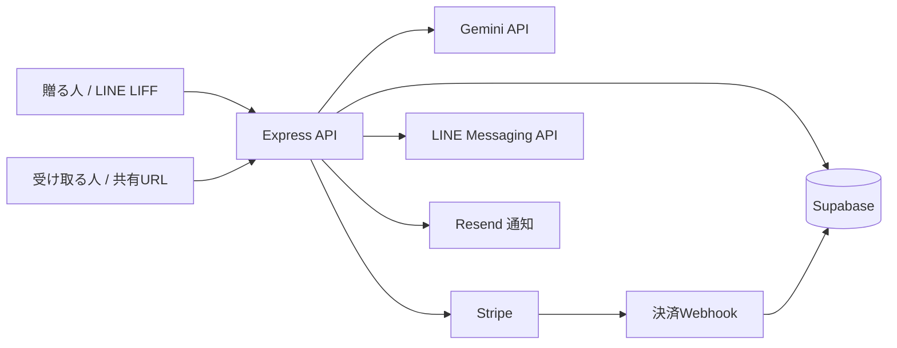

# Giftalk — LINEを起点としたeギフトの試作

## 概要

大学院の企業連携PBLで、LINEから贈れるeギフトを設計・実装しました。贈る人がAIに相談して複数の候補を選び、受け取る人が最後に1つを選ぶ仕組みです。

## 背景と課題

研究テーマは、LINEを起点としたOMO（ネットと店舗の連携）の仕組みと購買データの活用です。カジュアルなギフトでは、相手の好みを外したくない一方、カタログギフトは贈る人が価格帯しか選べず、1商品に絞る方式も好みから外れるおそれがあります。そこで、贈る側の気持ちと受け取る側の選択を両立する流れを考えました。

## 仕組み

1. 贈る人がAIに相談し、同価格帯の候補を複数選んで決済する。
2. 受け取りURLをLINEで送り、受け取る人が候補から1つ選ぶ。
3. 最初のPoCでは配送で受け取る想定とし、受け取る人が配送先を登録する。

## 購買データの使い道

贈る人の候補と事前予想、受け取る人の最終選択、AIとの会話を記録する設計です。予想と実際の選択のずれ、AI相談の有無や推薦の見せ方による選び方の違いを、実証後に検討します。現時点で効果が確認されたという主張ではありません。

## 本人の役割と現在の段階

本人はeギフトの提案と、サーバー側の設計・実装を担当しました。**実装の多くはAIエージェント（Claude Code・Codex）を活用しました。** 実証（PoC）は連携企業の決裁待ちで、利用者を対象とした結果はまだありません。

## 設計の判断

- 候補を同価格帯に限定し、決済額と受け取る人の選択がずれないようにしました。
- 受け取りURLには乱数トークンを付け、DBにはそのハッシュだけを保存します。`giftId` だけでは受け取り情報の取得や更新ができません。
- 初回の実証は配送を想定します。店頭受け取りとQRコードの処理もコードにはありますが、今回のPoC範囲とは分けて評価する必要があります。

## 構成

Node.js / Express、HTML・JavaScript、LIFF、Supabase（PostgreSQL）、Stripe、Gemini API、Resendを使用しています。Vercel向けのルーティング設定も含みます。

## データの設計

- `gifts`: 候補（`items`）、贈る人の予想（`sender_prediction`）、受け取る人の選択（`selected_item_id` と時刻）、配送状態を保存します。配送先はこのテーブルに入り、受け取りAPIの応答には含めません。
- `conversation_logs` と `chat_histories`: AI相談の発言・応答と会話履歴を保存します。`funnel_events` は推薦表示や選択などのイベントを記録します。
- `purchases`: 決済と購入商品の情報を保存します。これらを照合する分析は設計段階で、利用者データによる検証は未実施です。

## セキュリティ上の工夫と限界

受け取りトークンは32バイトの乱数で発行し、SHA-256ハッシュを `gifts.recipient_token_hash` に保存します。取得・選択・配送先・変更依頼などのAPIではトークンを照合し、取得応答は表示に必要な列だけに絞っています。配送先の確定前には受取人確認のチェックを求めます。ただし、これは**共有URLの所持確認**であり、LINEアカウントとの厳密な本人照合ではありません。URLを第三者に渡すと、その人も操作できます。共有URLの取り扱いと、住所・会話ログの保存期間は実証前に決める必要があります。

贈る人の予想を送るAPIも同じトークンを使うため、URLを受け取った側が予想を書き換えられる余地があります。分析に使う前に、贈る人と受け取る人を別々に確認する仕組みが必要です。

## セットアップ

1. Node.jsと既存のSupabaseデータベースを用意し、`npm ci` で依存を入れます。このリポジトリには既存テーブル全体の作成SQLや商品データは含まれていません。
2. `.env.example` を `.env` にコピーし、値を自分の開発用設定に置き換えます。秘密鍵はサーバー側にのみ設定します。
3. 既存の `gifts` テーブルに [migrations/001_recipient_token.sql](migrations/001_recipient_token.sql) を適用します。適用前のギフトにはトークンがないため、そのままでは新しい受け取りURLを使えません。必要なものは管理画面の再送機能で新しいトークンを発行します。再送すると以前の受け取りURLは無効になります。
4. LINEのLIFFとMessaging API、StripeのWebhookを設定し、`BASE_URL` を公開するHTTPSオリジンにします。ローカル起動は `npm start`、Vercelでの開発は `npm run vercel-dev` です。

### 環境変数

| 変数 | 用途 |
| --- | --- |
| `BASE_URL`, `PORT`, `LIFF_ID` | 公開オリジン、ローカルポート、LIFFのID |
| `LINE_CHANNEL_SECRET`, `LINE_CHANNEL_ACCESS_TOKEN` | LINE Webhook検証と送信 |
| `SUPABASE_URL`, `SUPABASE_SERVICE_ROLE_KEY` | DB接続（service role keyは非公開） |
| `GOOGLE_AI_API_KEY` | AI相談 |
| `STRIPE_SECRET_KEY`, `STRIPE_PUBLISHABLE_KEY`, `STRIPE_WEBHOOK_SECRET` | 決済とWebhook検証 |
| `RESEND_API_KEY`, `NOTIFICATION_EMAIL`, `NOTIFICATION_FROM` | 通知メール |
| `ADMIN_USER`, `ADMIN_PASS` | 管理画面のBasic認証 |

## 今後

既存テーブルの作成SQLとダミー商品データを整備し、実サービスを使う結合試験を行う必要があります。実証が認められた場合は、配送フローの検証、受取人の本人確認方法、データ保存期間と分析手順を連携企業と確定します。

現状のリポジトリにはOGP画像とStripeのリダイレクト戻り先ページが含まれません。画像付き共有表示とリダイレクトが必要な決済方法は、そのファイルを整備してから確認します。
